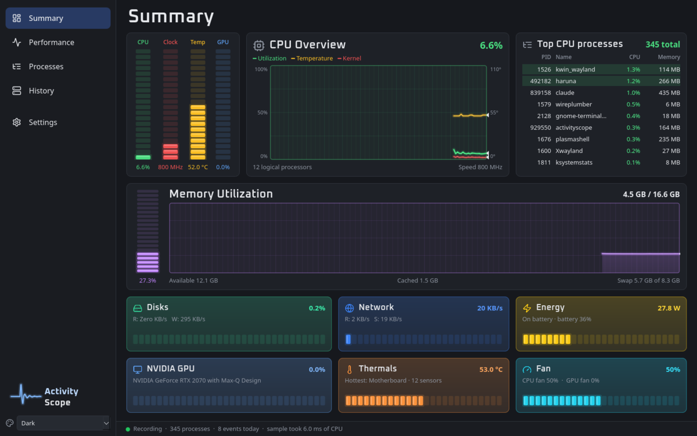

# ActivityScope

A task manager for Linux that remembers. It shows what is using your computer
right now, lets you sort, inspect and end processes, and keeps a record of
every stretch of heavy CPU, memory, disk, GPU or heat load together with the
programs that caused it. When the fan spins up and then settles before you can
look, the History page still knows what it was.

Written in C++20 with Qt 6. It never asks for root.



## What it does

- **Summary, Performance, Processes.** Live meters and graphs for CPU (per
  core), memory and swap, each GPU, each disk, network, battery and thermals.
  The process view groups your apps, background services and system
  processes, nests children under the program that started them, and can
  pause, resume or end a process.
- **History.** A timeline of the last 24 hours with every recorded event
  marked. Each event gets a plain-language summary, the conditions that
  tripped it, a graph that includes the minute before it started, and a ranked
  list of culprits. Clicking any moment on the timeline shows which programs
  were busiest then, even if nothing crossed a threshold.
- **Shutdown watch.** Warns before the system turns itself off for heat (see
  below), and records every past shutdown it finds in the system log.
- **Log.** One timeline of everything worth knowing in an investigation:
  USB devices and boards plugged in and out, drives connected, mounted,
  formatted or partitioned (and by which program), boards flashed (tool,
  port, board and firmware file), packages installed or removed, sudo and
  pkexec commands, sleep, wake, lid and power changes, network changes,
  failed services, crashes and out-of-memory kills, and programs run for the
  first time from outside the system folders, changes to the places programs
  use to start themselves (with the lines added or removed), and the first
  connection made by any program from outside the system folders. Searchable,
  filterable by kind, and exportable as a text file.
- **Background sharing warning.** When a program talks to 8 or more different
  computers within 10 minutes (the way torrent clients do) and you have not
  allowed it, a notification names it, with buttons to quit it or allow it.
- **Program and connection history.** Every program that ran (long enough to
  be seen, about one to three seconds) with its command line, parent, user,
  start, end, CPU time and peak memory; and every program-to-address pair with
  when it was first and last seen. Kept 30 days.
- **System pages.** System info, startup apps (with on and off switches),
  users and their sessions, services (start, stop and restart your own),
  network connections by program, installed apps with their package, version
  and size, disk space with a folder-size scan, and power and clock speeds.
- **Updates, on request only.** Nothing is checked or installed until you
  press a button. Check for updates lists every pending package from the
  official repositories (through `checkupdates`, which never touches the
  system's own package database) and the AUR (through `paru`), marks the ones
  that need a restart. Each package has an Update and a Hold button, and Update all runs the full
  upgrade. Updates run in a visible terminal where you type your password.
  Packages held in `pacman.conf` (`IgnorePkg`) or with the Hold button are
  never touched: they are passed to pacman and paru as `--ignore`.
- **Conflict alerts.** After a check, Update all is rehearsed on a scratch
  copy of the package database (no root, nothing on the system changes). When
  pacman would refuse, the reason is explained in plain words with the facts
  behind it and a fix, and the fix is applied to the copy and the rehearsal
  repeated, so the alert can say the fix was tested. Fixes are buttons: remove
  packages that were dropped from the repositories (the exact removal list
  comes from pacman's own preview), hold a package, or rebuild an AUR package.
  It also warns about AUR programs that load a library the upgrade removes,
  kernels whose headers lag behind installed DKMS drivers, held packages whose
  requirements or libraries the upgrade breaks, a new Python minor version
  (pip packages, virtual environments and AUR Python packages that need
  redoing), and too little disk space.
- **Weird processes.** A front end for the `weird` command (npm package
  thatsweird), which judges whether what is running and installed can be
  trusted from the distribution's own signed package data. Scans run only on
  the button, as the user, never as root. Findings appear in weird's own
  plain words, worst first, with the full explanation, the MITRE ATT&CK
  technique where weird names one, a jump to the live process, and a Trust
  button that pins a program's fingerprint so later scans stay quiet until
  the file changes. If weird is not installed the page says how to get it.
- **Popout.** A small always-on-top readout of CPU, memory, GPU, heat and fan.
- **Routine or notable.** Every event is judged when it closes: work you
  started yourself (an app, or a command typed into a terminal) is routine
  and drawn quietly; red is kept for events that deserve attention on their
  own, such as shutdown danger, swap trouble, a dead fan, or a background
  service as the main cause. Three preset buttons in Settings (Sensitive,
  Normal, Quiet) set all trigger thresholds at once; every number stays
  editable. Programs whose end was never seen (a crash or power loss) are
  closed on the next start with an honest estimated end. Per-program network
  byte counts would need administrator rights, so they are deliberately
  absent: the history records who connected where, not how much they sent.
- **Ask.** Plain questions answered from the records, with receipts.
- **About.** The last sidebar entry explains the whole program from inside
  it: what it records, the guard, the investigation kit, every page, and the
  rules it lives by.
- **Always recording.** The app lives in the system tray. Closing the window
  keeps it recording; quitting from the tray menu stops it.

## Installing

    ./install.sh

No root at any point. The script compiles the program, installs it under
~/.local, starts the tray recorder now and at every login, makes the
bundled weird scanner available as the weird command when no system copy
exists, and adds ~/.local/bin to PATH for bash and fish if it is missing.
Needs cmake, a C++ compiler, Qt 6, libsystemd, libudev, python3 and rsync.

A copy of the weird scanner (npm package thatsweird, same author) ships in
vendor/ and installs with the program, so the Weird processes page works
from a plain checkout. Installing thatsweird from npm gives a
self-updating copy, which is then preferred automatically.

## How it catches programs that are already gone

Sampling once a second misses a compiler that runs for 200 ms. ActivityScope
still accounts for that work in three ways, none of which need root:

1. **Exit tracking.** A process seen last second and gone now is kept with its
   final totals and marked as exited.
2. **Reaped children.** When a process exits, the kernel adds its CPU time to
   its parent. ActivityScope compares that with what it saw by name, so a
   burst of tiny programs shows up as "programs too brief to catch by name,
   started by make".
3. **Systemd units.** Every app and service runs in its own cgroup, whose CPU
   counter keeps counting processes that have exited.

Short-lived processes with the same name and parent are grouped, for example
"512 short-lived cc1plus processes started by make".

## Events

An event opens when one of these holds for a few seconds (all adjustable in
Settings):

| Resource | Default trigger |
| --- | --- |
| CPU | over 50% for 2 s, one core at 95% for 3 s, one program over 25% of the machine, or 50 new processes in 5 s |
| Memory | programs waiting on memory over 2% of the time, swap-in over 1 MB/s, free memory falling 500 MB in 10 s, or one program growing 300 MB in 10 s |
| Disk | busy over 60% or moving over 50 MB/s for 3 s |
| GPU | load over 50% for 3 s, or video memory jumping by 500 MB |
| Heat | CPU at 85 °C, a rise of 15 °C in 30 s, fan over 85%, or the fan stepping up 20 points |

It closes after 30 calm seconds. Triggers that arrive while it is open are
merged into the same event.

## Before the machine shuts itself down for heat

Linux turns the machine off when its critical thermal zone reaches its limit
(on the laptop this was built on, the `acpitz` zone at 100 °C). ActivityScope
reads that zone and its limit from the system rather than assuming a number:

- It works out how fast the sensor is climbing and how many seconds are left
  at that rate. The sensor can jump 20 °C for a single second, so decisions use
  the middle of the last three readings, and a countdown is only given within
  20 °C of the limit.
- Within 5 °C of the limit, or about 20 seconds away, it shows a critical
  desktop notification naming the program using the most CPU, with a button to
  pause it. A paused program keeps its work and carries on when you resume it.
  The warning is withdrawn once things calm down.
- Heat events say how close the machine came ("within 3 °C of the 100 °C
  point, about 6 seconds away at its fastest climb").
- A fan that stays at 0% while the other fan works hard and the CPU is hot is
  called out as not spinning.
- Near the limit, history is written to disk every second, so a sudden
  power-off still leaves a record. When the app starts it reads how earlier
  boots ended and records each heat shutdown or unexplained power-off.

## Where the log comes from

Everything is read as your own user: device events from udev, the system
journal (followed from where the last run stopped, so nothing is lost while
the app is closed), `/var/log/pacman.log`, the mount table, and the process
list for flashing and disk tools. Repeats are folded ("zsh crashed 8 times
between 16:23:01 and 16:23:12"). Without root it cannot see which files were
copied to or from a drive, only that the drive came and went.

## Startup locations it watches

Changes to these are logged with the lines that were added or removed:
your autostart folder, your systemd user services (including the `.wants`
links that enable them), `~/.local/bin`, shell startup files (bash, zsh, fish,
profile), Plasma login and logout scripts, session environment files, and in
`/etc`: hosts, environment, `ld.so.preload` (flagged as a warning when it
appears), fstab, crontab, passwd and group, system and per-user services,
system autostart, `profile.d`, cron folders, udev rules, kernel module settings
and pacman hooks. Files the user cannot read are still reported as changed.

## ask: plain questions, deterministic answers

    ask why did the fan scream last night
    ask what crashed this week
    ask what did blender do yesterday

The Ask page (and the ask command) answer plain questions from the history
database through unllm, the bundled deterministic language library (same
author, vendor/unllm): time phrases, topic detection, typo-tolerant program
names, BM25 retrieval and rule-based grammar, costing microseconds. No
model runs and nothing leaves the machine. Every answer carries the records
it stands on, and a question outside the machine's domain is refused in so
many words ("I can't answer that"), never guessed at and never met with
silence.

## hindsight: the config time machine

The question history alone cannot answer is "what changed?". hindsight,
installed alongside the app, answers it:

    hindsight snap            take a snapshot of /etc and your config files
    hindsight "2 days ago"    the story since then, in time order
    hindsight diff "2 weeks ago"   everything that changed in config since

Snapshots are commits in a private local git repository at
~/.local/share/hindsight/repo (mode 700, never pushed anywhere). A daily
timer takes one, the Updates page takes one before running an upgrade, and
credential stores, keys, caches, browser profiles and anything over 512 KB
are never copied, so no snapshot ever needs root or holds a secret. The
story interleaves ActivityScope's events and log, config changes and
pacman's history into one chronological answer. Its tests:
python3 -m unittest discover -s tests -p "test_hindsight.py"

## Answering "what just happened?" from a terminal

Everything is in one SQLite file, `~/.local/share/activityscope/history.db`:

```sh
sqlite3 ~/.local/share/activityscope/history.db \
  "select datetime(start,'unixepoch','localtime'), summary from events order by start desc limit 5"
```

Tables: `samples` (one row per second, kept 24 hours), `minute_top` (the
busiest programs of each minute, kept 24 hours), `events`, `event_culprits`
and `event_samples` (kept 30 days), `log` (kept 90 days), and `procs` and
`connections` (kept 30 days). The `v_timeline` view puts log entries, resource
events, program starts and ends, and first connections in one time-ordered
list, so a moment can be examined with a single query:

```sh
sqlite3 ~/.local/share/activityscope/history.db \
  "select datetime(t,'unixepoch','localtime'), kind, title from v_timeline
   where t between strftime('%s','2026-10-10 14:25','utc') and strftime('%s','2026-10-10 14:40','utc') order by t"
```

The plain log on its own:

```sh
sqlite3 ~/.local/share/activityscope/history.db \
  "select datetime(t,'unixepoch','localtime'), category, title from log order by t desc limit 20"
```

## Popout skins

Right-click the popout to pick a skin. Besides the built-in ones, any JSON
file in `~/.config/activityscope/skins/` becomes a skin. A skin is colours
only, nothing in it can run, and anything left out is taken from the app
theme:

```json
{ "name": "Midnight", "window": "#0b1020", "text": "#e8ecff", "cpu": "#7cf0a0", "heat": "#ff8a5c" }
```

Keys: `window`, `panel`, `text`, `dim`, `cpu`, `memory`, `gpu`, `heat`, `fan`.

## Cost

Measured on an i7-10750H laptop while hidden in the tray: about 0.75 s of CPU
per minute (roughly 1.3% of one core) and about 75 MB of its own memory, plus
shared libraries and system-log pages the kernel can reclaim at any time. All processes
are scanned every second while the machine is busy and every 3 s while it is
calm, which loses nothing because CPU time is averaged over the gap. Slow
sensors are read less often: the battery every 10 s (each read takes about
100 ms of firmware time), drive and Wi-Fi temperatures every 5 s, NVIDIA's
load every 3 s and its power and clock every 15 s. A sleeping laptop GPU is
never woken to be measured, and when the GPU is idle the app lets go of it so
it can sleep.

## Sharing with conky

ActivityScope writes `$XDG_RUNTIME_DIR/activityscope/conky.txt` every second
(it lives in RAM). Each line is `key value`: CPU and per-core load, clock,
temperatures, fans, NVIDIA load and memory, disk and network rates, and the top
8 processes as `topN cpu% mem% name`. A conky config can read it instead of
measuring the same things again.

## Build

Needs CMake 3.24 or newer, a C++20 compiler, Qt 6 (Widgets, Svg, Network) and
SQLite 3.

```sh
cmake -S . -B build -G Ninja
cmake --build build
./build/ascore_tests
cmake --install build --prefix ~/.local
```

To start it hidden at login, tick "Start recording when I log in" in Settings,
or install `systemd/activityscope.service` as a user unit.

## Layout

- `src/core` measures and records: readers for `/proc` and `/sys`, the event
  engine and the SQLite store. It has no Qt dependency and is tested against
  fake `/proc` and `/sys` trees in `tests/`.
- `src/app` is the Qt interface and the recorder thread.

## Credits

The look is inspired by Dave Plummer's Task Manager TMOG. Headings use the
Oxanium font and icons come from Lucide; see `THIRD_PARTY_NOTICES.md`.

## License

MIT
